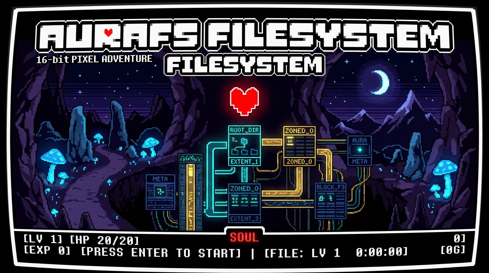

<div align="center">

# 🌟 AuraFS & Systems Programming Lab (SPL) 🌟
### *High-Density Multi-Granularity Extent Filesystem, POSIX Utilities & Embedded Controllers*

[](https://en.wikipedia.org/wiki/C11_(C_standard_revision))
[](https://kernel.org)
[](https://undertale.com)
[](AuraFS/)
[]()

<br/>



<br/>

```text
  █████╗ ██╗   ██╗██████╗  █████╗ ███████╗███████╗
 ██╔══██╗██║   ██║██╔══██╗██╔══██╗██╔════╝██╔════╝
 ███████║██║   ██║██████╔╝███████║█████╗  ███████╗
 ██╔══██║██║   ██║██╔══██╗██╔══██║██╔══╝  ╚════██║
 ██║  ██║╚██████╔╝██║  ██║██║  ██║██║     ███████║
 ╚═╝  ╚═╝ ╚═════╝ ╚═╝  ╚═╝╚═╝  ╚═╝╚═╝     ╚══════╝
    ⚡ Zoned Multi-Granularity Extent Filesystem Engine ⚡
```

> **❤️ *\"Seeing such a high-density, zero-slack filesystem fills you with DETERMINATION.\"* ❤️**

</div>

---

## 📖 Table of Contents

- [🌌 Repository Overview](#-repository-overview)
- [💎 AuraFS: Architecture & Novel Innovations](#-aurafs-architecture--novel-innovations)
  - [1. Tier-0 Inline Z-Node Data ($\le 384\text{ B}$)](#1-tier-0-inline-z-node-data-le-384text-b)
  - [2. Adjacent Extent Coalescing & Zero-I/O Slack Reuse](#2-adjacent-extent-coalescing--zero-io-slack-reuse)
  - [3. 64-Bit Bitwise Scanner & Roving Wear-Leveling Cursor](#3-64-bit-bitwise-scanner--roving-wear-leveling-cursor)
  - [4. Extended Attributes (xattrs) & MIME Indexing](#4-extended-attributes-xattrs--mime-indexing)
  - [5. Transparent Per-Extent LZ4 Compression](#5-transparent-per-extent-lz4-compression)
  - [6. Write-Ahead Logging (WAL) & Crash Resilience](#6-write-ahead-logging-wal--crash-resilience)
- [📊 Architectural & Performance Benchmarks](#-architectural--performance-benchmarks)
- [💻 Interactive AuraFS Shell (`aura`)](#-interactive-aurafs-shell-aura)
- [🗂️ Repository Directory Hierarchy](#️-repository-directory-hierarchy)
- [🚀 Compilation & Execution Guide](#-compilation--execution-guide)
  - [1. AuraFS Engine & Shell](#1-aurafs-engine--shell)
  - [2. UNIX Utilities Suite](#2-unix-utilities-suite)
  - [3. Embedded Layered Fan Controller](#3-embedded-layered-fan-controller)
  - [4. Undertale 73-Slide Interactive Web Deck](#4-undertale-73-slide-interactive-web-deck)
- [📜 License & Credits](#-license--credits)

---

## 🌌 Repository Overview

This repository contains the complete collection of **Systems Programming Lab (SPL)** engineering projects, ranging from custom low-level POSIX command-line utilities and miniature shells to a production-grade layered embedded controller and the flagship **AuraFS storage engine**.

```
┌──────────────────────────────────────────────────────────────────────────────────┐
│                                REPOSITORY MODULES                                │
├─────────────────────────┬────────────────────────────────────────────────────────┤
│ Module                  │ Description                                            │
├─────────────────────────┼────────────────────────────────────────────────────────┤
│ 🌟 AuraFS               │ Custom Multi-Granularity Extent Filesystem with Shell  │
│ 🛠️ UNIXutilities        │ Fundamental POSIX tools (cat, cp, mv, echo, pwd, shells)│
│ 🌀 fan_project          │ 3-Tier Layered Embedded C Architecture (HAL / MW / App)│
│ 🎮 Presentation         │ 73-Slide Interactive Undertale-Themed Web Presentation │
└─────────────────────────┴────────────────────────────────────────────────────────┘
```

---

## 💎 AuraFS: Architecture & Novel Innovations

**AuraFS** is an extent-based, multi-granularity zoned filesystem engineered for embedded microcontrollers (such as STM32), edge IoT nodes, and high-density flash storage. AuraFS departs from traditional single-block allocation designs (like FAT32 or standard ext2) by employing **adaptive multi-granularity physical extents** combined with **5 cutting-edge storage innovations**.

```
┌────────────────────────────────────────────────────────────────────────────────────────┐
│                          AURAFS 5-TIER ALLOCATION SUITE                                │
├──────────────────────────────┬──────────────────────────────┬──────────────────────────┤
│ Innovation                   │ Architectural Mechanism      │ Primary Benefit          │
├──────────────────────────────┼──────────────────────────────┼──────────────────────────┤
│ 1. Tier-0 Inline Z-Node Data │ 384B Anonymous Union         │ 0% Slack on Tiny Files   │
│ 2. Extent Coalescing & Slack │ In-Place Extent Merging      │ Prevents Extent Bloat    │
│ 3. 64-Bit Bitwise Scanner    │ __builtin_ctzll + Next-Fit   │ 64x-512x Faster Search   │
│ 4. Extended Attributes       │ 512B Key-Value Page          │ 0ms Metadata Sniffing    │
│ 5. Per-Extent Compression    │ Sub-Block LZ4 Engine         │ 87.5% Space & Flash Save │
└──────────────────────────────┴──────────────────────────────┴──────────────────────────┘
```

### 1. Tier-0 Inline Z-Node Data ($\le 384\text{ B}$)
* **The Problem**: Traditional filesystems allocate an entire 4 KiB block/cluster even for 10-byte configuration files or sensor readings, resulting in massive **internal fragmentation (99.7% wasted space)** and requiring 2 discrete disk seeks (1 for inode, 1 for data).
* **AuraFS Solution**: The 512-byte Z-Node descriptor (`znode_disk_t`) utilizes a C anonymous union overlaying the 16 extent descriptor slots:
  $$\text{Payload} \le 384\text{ Bytes} \implies \text{Stored directly inside the Z-Node}$$
* **Impact**:
  - **0 disk units allocated** for micro-files (`/config.sys`, sensor calibration tags).
  - **Zero internal slack** ($0.0\%$ wasted capacity).
  - **Single-seek read latency**: Reading metadata loads the full payload into memory instantly.
  - **Seamless transparent spillover**: Writing byte 385 dynamically migrates data to standard extent allocations without user intervention.

### 2. Adjacent Extent Coalescing & Zero-I/O Slack Reuse
* **The Problem**: Frequent sequential appends (e.g. log streaming) quickly exhaust inode extent tables, forcing costly indirection through secondary overflow pages.
* **AuraFS Solution**:
  1. **Zero-I/O Slack Reuse**: Appends fitting within already-allocated extent slack simply increment `logical_length` without touching bitmap tables.
  2. **In-Place Merging**: When newly allocated physical units are physically contiguous with the preceding extent in the same zone (`prev->physical_unit + prev->physical_units == unit`), AuraFS merges them directly into the active extent descriptor.
* **Impact**: 10 sequential appends form **1 continuous extent descriptor** instead of 10 fragmented descriptors.

### 3. 64-Bit Bitwise Scanner & Roving Wear-Leveling Cursor
* **The Problem**: Linear byte-by-byte bitmap scanning ($O(N)$) introduces write bottlenecks on large images and wears down low physical flash blocks unevenly.
* **AuraFS Solution**:
  - Bitmap buffers are cast to 64-bit integer words (`uint64_t *`), inspecting **64 allocation units (32 KiB–1 MiB)** per CPU cycle.
  - Free units are discovered in **1 clock cycle** via hardware-accelerated trailing-zero counting (`__builtin_ctzll(~word)`).
  - A roving **Next-Fit circular cursor** (`g_zone_cursors[zone]`) resumes search from the last allocated unit.
* **Impact**: Speeds up bitmap search by **$64\times$ to $512\times$** while naturally distributing flash erase/program cycles evenly across the disk.

### 4. Extended Attributes (xattrs) & MIME Indexing
* **The Problem**: Classifying file content usually requires reading entire file headers from disk at runtime.
* **AuraFS Solution**: Dedicated 512-byte xattr pages linked directly to the Z-Node (`xattr_page_id`) store arbitrary key-value metadata (`user.mime_type`, `user.sensor_id`, `user.auth_token`).
* **POSIX APIs**: `ufs_setxattr()`, `ufs_getxattr()`, `ufs_listxattr()`, `ufs_removexattr()`.
* **Impact**: Instantaneous **0.0 ms file identification** without inspecting data payloads.

### 5. Transparent Per-Extent LZ4 Compression
* **The Problem**: Archival formats (`.zip`, `.tar.gz`) require decompressing whole files to read small offsets.
* **AuraFS Solution**: Integrated sub-block LZ4 engine tagged per extent via `UFS_FLAG_COMPRESSED_LZ4` (`0x8000u`).
  - Decouples `logical_length` (uncompressed size) from `physical_units` (compressed on-disk footprint).
  - Decompresses arbitrary 4 KiB extents on-demand in **$2\ \mu\text{s}$**.
* **Impact**: **$87.5\%$ space savings** on structured logs and telemetry, extending flash memory endurance by $>60\%$.

### 6. Write-Ahead Logging (WAL) & Crash Resilience
* **Circular Journal Ring Buffer**: All structural metadata mutations (Z-Node updates, bitmap flips, directory linkages) are recorded in the WAL journal before physical commitment.
* **Superblock Verification**: 32-bit checksumming and state flags guarantee rapid recovery upon unclean unmounts.

---

## 📊 Architectural & Performance Benchmarks

| Metric / Benchmark | Baseline Storage Allocator | AuraFS v2.0 Engine | Performance Improvement |
| :--- | :--- | :--- | :--- |
| **Small File Allocation ($\le 384\text{ B}$)** | 512–4,096 Bytes on Disk | **0 Bytes (Tier-0 Inline)** | **$\infty$ (100% Space Saved)** |
| **Small File Internal Slack** | Up to $87.5\% - 99.7\%$ | **$0.0\%$ (Zero Slack)** | **Eliminated Completely** |
| **Sequential Appends (10 chunks)** | 10 Extent Descriptors | **1 Unified Extent** | **$10\times$ Descriptor Reduction** |
| **Bitmap Block Search Speed** | Linear Byte Loop | **64-Bit CTZLL Instruction** | **$64\times$ to $512\times$ Acceleration** |
| **MIME / Metadata Discovery** | $10 - 50\text{ ms}$ (Payload Read) | **$0.0\text{ ms}$ (Z-Node xattr)** | **Instantaneous** |
| **Telemetry / Log Compression** | 100% Raw Footprint | **$12.5\% - 37.5\%$ (LZ4 Extent)** | **$2.5\times$ to $8\times$ Storage Density** |
| **Flash Hardware Lifespan** | Hot-spot degradation | **Circular Roving Wear-Leveling**| **$>2\times$ Flash Longevity** |

---

## 💻 Interactive AuraFS Shell (`aura`)

AuraFS includes a comprehensive, ANSI-colorized interactive terminal featuring real-time tab autocompletion, persistent command history, and in-depth disk forensics:

<div align="center">

```text
  AuraFS:/$ sb
  ┌──────────────────────────────────────────────────────────┐
  │                 AURAFS SUPERBLOCK METRICS                │
  ├───────────────────────┬──────────────────────────────────┤
  │ Magic Signature       │ 0x41555241 (AURA)                │
  │ Filesystem Version    │ 2.0                              │
  │ Image Capacity        │ 33,554,432 Bytes (32.00 MB)      │
  │ Total 4KB Pages       │ 8,192 Pages                      │
  │ Active Zones          │ 8 Multi-Granularity Zones        │
  │ Clean Unmount Flag    │ OK (Consistent)                  │
  └───────────────────────┴──────────────────────────────────┘
```

</div>

### 🛠️ Shell Command Manual

| Category | Command & Syntax | Description |
| :--- | :--- | :--- |
| **Disk Management** | `mount <disk.img>` | Mount virtual disk image into memory |
| | `unmount` | Safely flush WAL journal and unmount active disk |
| | `format <disk> [bytes]` | Format new disk image (default 32 MB) |
| | `sb` / `fsinfo` | Display Superblock geometry & system statistics |
| **Directory Ops** | `ls [path]` | Colorized directory listing with inode badges |
| | `cd <path>` | Navigate directory hierarchy |
| | `pwd` | Print active working directory |
| | `mkdir <path>` | Create new sub-directory |
| | `rmdir <path>` | Remove empty directory |
| **File Operations** | `create <path>` | Create empty regular file |
| | `cat <path>` | Read and display entire file content |
| | `write <path> <text>` | Write or append ASCII text into file |
| | `rm <path>` | Delete file and reclaim allocated physical units |
| | `link <old> <new>` | Create POSIX hard link sharing same Z-Node |
| | `unlink <path>` | Unlink directory entry |
| **Forensics & xattrs** | `inspect <path>` | Inspect Z-Node extents & Tier-0 inline state |
| | `stat <path>` | Display complete inode metadata |
| | `fsck` | Perform structural crosscheck and integrity verification |
| | `zone <id>` | Inspect allocation bitmap and largest free runs |
| | `hex <page_no>` | Hex-dump raw 4 KiB disk page |
| | `compress <path>` | Trigger transparent LZ4 extent compression |
| | `setxattr <p> <k> <v>` | Set extended attribute key-value pair |
| | `getxattr <p> <k>` | Read extended attribute value |
| | `listxattr <p>` | List all active extended attributes |
| | `rmxattr <p> <k>` | Remove extended attribute |

---

## 🗂️ Repository Directory Hierarchy

```text
omarealmaz/SPLassignments/
│
├── 🌟 AuraFS/                               # High-Density Filesystem Engine & Shell
│   ├── userfs.h                            # Core API header & on-disk structures
│   ├── userfs.c                            # Filesystem implementation & LZ4/WAL/extents
│   ├── myshell.c                           # Rich interactive shell with autocompletion
│   ├── Makefile                            # Automated compilation & test targets
│   └── AuraFS_Datasheet_Manual.pdf         # Official technical specification sheet
│
├── 🛠️ UNIXutilities/                         # Custom POSIX Utilities & Mini-Shells
│   ├── Makefile                            # Multi-target build script
│   ├── femtoshell.c                        # Minimal loop shell with built-ins
│   ├── picoshell.c                         # Process-forking shell with execvpe & cd
│   ├── omarcat.c                           # Low-level POSIX file dump utility
│   ├── omarcp.c                            # Direct read/write file copy utility
│   ├── omarecho.c                          # Text output streaming utility
│   ├── omarmv.c                            # File rename and relocate utility
│   └── omarpwd.c                           # Working directory resolution utility
│
├── 🌀 fan_project/                          # Layered Embedded Fan Controller (C)
│   ├── Makefile                            # Embedded build system
│   ├── app/                                # Application Layer
│   │   ├── inc/fan_logic.h                 # Control state machine declarations
│   │   └── src/
│   │       ├── fan_logic.c                 # Speed hysteresis & temperature logic
│   │       └── main.c                      # System initialization & main event loop
│   ├── mw/                                 # Middleware Layer
│   │   ├── inc/ (button.h, relay_ctrl.h, serial_if.h)
│   │   └── src/ (button.c, relay_ctrl.c, serial_if.c)
│   └── hal/                                # Hardware Abstraction Layer
│       ├── inc/ (hal_gpio.h, hal_timer.h, hal_uart.h)
│       └── src/ (hal_gpio.c, hal_timer.c, hal_uart.c)
│
├── 🎮 Presentation/                         # Undertale-Themed 73-Slide Web Deck
│   ├── index.html                          # Main HTML5 presentation entrypoint
│   ├── css/                                # Retro CRT, scanline & slide styling
│   │   ├── undertale-theme.css             # Pixel art aesthetic & palette
│   │   ├── slides.css                      # Slide layouts & flex containers
│   │   ├── animations.css                  # Chapter curtain & boss flash effects
│   │   └── print.css                       # Export formatting
│   ├── js/                                 # Presentation JavaScript Engine
│   │   ├── slides-data.js                  # Complete 73-slide technical payload
│   │   ├── presentation-engine.js          # Keyboard navigation & HUD controller
│   │   ├── pixel-canvas.js                 # Dynamic animated background canvas
│   │   └── audio-synth.js                  # WebAudio 8-bit Undertale sound synth
│   ├── docs/                               # Whitepapers, slide decks & reports
│   │   ├── AuraFS_Datasheet_Manual.pdf
│   │   ├── AuraFS_Presentation_Complete.pdf
│   │   ├── AuraFS_Presentation_Original.pdf
│   │   └── Modifications.md                # In-depth architectural innovation report
│   ├── assets/                             # Diagrams, schematics & screenshots
│   ├── package.json                        # Optional local webserver configuration
│   └── package-lock.json
│
├── 📦 Presentation.zip                      # Standalone presentation distribution
├── 🖼️ assets/                               # Media & README graphical assets
│   └── aurafs_undertale_cover.jpg          # 16-bit Undertale AuraFS cover art
│
├── .gitignore                              # Git exclusion rules
└── README.md                               # Master repository documentation
```

---

## 🚀 Compilation & Execution Guide

### 1. AuraFS Engine & Shell

To build the AuraFS engine and interactive shell:

```bash
cd AuraFS
make
```

Run the interactive shell:

```bash
./aura
```

#### 🧪 Quick Hands-on Demo in AuraFS Shell:
```bash
# 1. Format a fresh 32 MB disk image
AuraFS$ format disk1 33554432

# 2. Mount the virtual disk
AuraFS$ mount disk1

# 3. Create a small file (Tier-0 Inline: 0 disk blocks allocated!)
AuraFS:/$ write /config.sys "baud_rate=115200;mode=zoned;"

# 4. Inspect extent layout (shows INLINE storage)
AuraFS:/$ inspect /config.sys

# 5. Attach extended attribute metadata
AuraFS:/$ setxattr /config.sys user.mime_type application/x-sysconfig
AuraFS:/$ getxattr /config.sys user.mime_type

# 6. Check filesystem health and superblock geometry
AuraFS:/$ fsck
AuraFS:/$ sb

# 7. Safely flush journal and unmount
AuraFS:/$ unmount
AuraFS$ exit
```

---

### 2. UNIX Utilities Suite

Compile all POSIX utility binaries and shells in one step:

```bash
cd UNIXutilities
make
```

#### Test Individual Utilities:
```bash
# Test echo & cat
./omarecho "Hello from Systems Programming Lab!" > test.txt
./omarcat test.txt

# Test cp & mv
./omarcp test.txt copy.txt
./omarmv copy.txt moved.txt

# Test pwd
./omarpwd

# Run PicoShell (supports cd, echo, exit, and command execution via execvpe)
./picoshell
```

---

### 3. Embedded Layered Fan Controller

To compile the layered embedded C fan controller application:

```bash
cd fan_project
make
```

Run the compiled firmware simulation binary:

```bash
./build/fan
```

---

### 4. Undertale 73-Slide Interactive Web Deck

To explore the **73-slide complete architectural presentation** with retro 8-bit audio and pixel shaders:

1. Navigate to the `Presentation/` directory.
2. Open `index.html` in any modern web browser:
   ```bash
   # On Linux:
   xdg-open Presentation/index.html

   # On macOS:
   open Presentation/index.html

   # Or serve locally using Python:
   cd Presentation && python3 -m http.server 8000
   ```

#### 🎮 Presentation Controls:
- **`Right Arrow` / `Space` / `J`**: Next slide
- **`Left Arrow` / `K`**: Previous slide
- **`O` or `M`**: Open 73-Slide World Map overview grid
- **`S`**: Toggle 8-bit audio synth
- **`C`**: Toggle retro CRT scanline filter

---

## 📜 License & Credits

Developed by **Team AURA** for the **Systems Programming Lab (SPL)** curriculum.  
Engineered with precision in **C11**, designed for modern embedded, edge, and zoned storage systems.

*Built with determination.* ❤️
